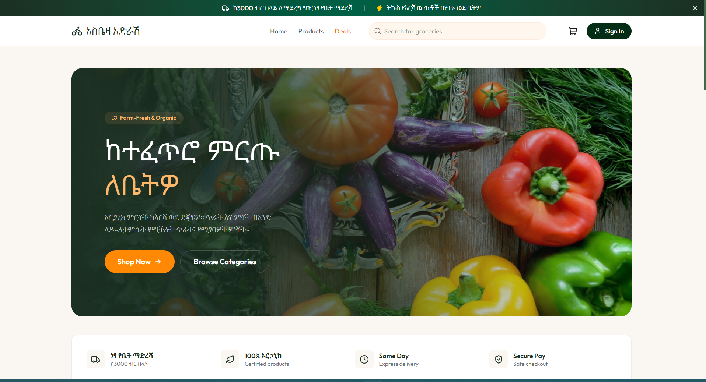
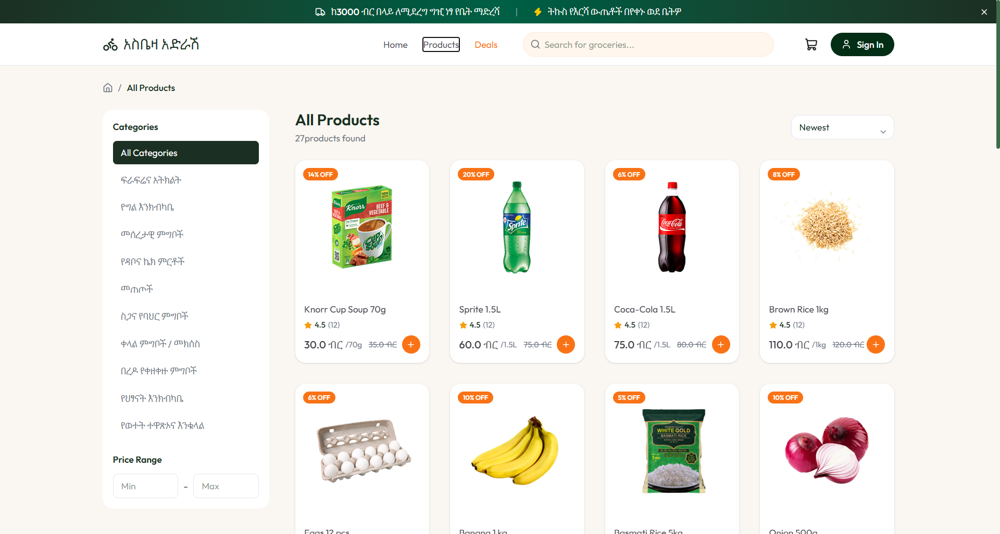
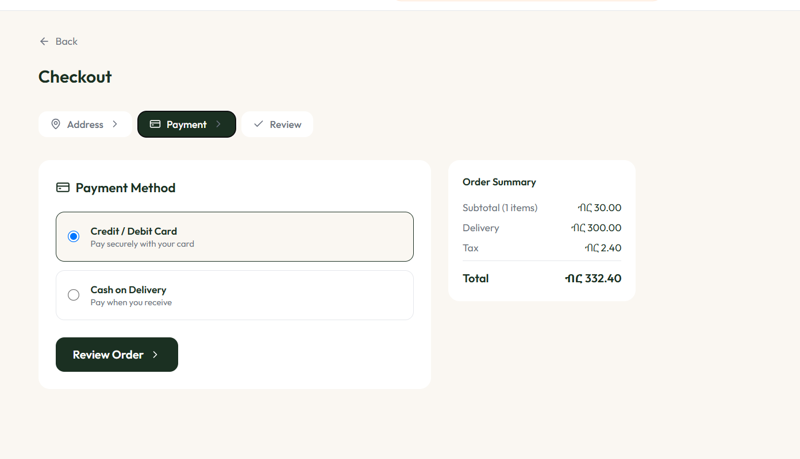
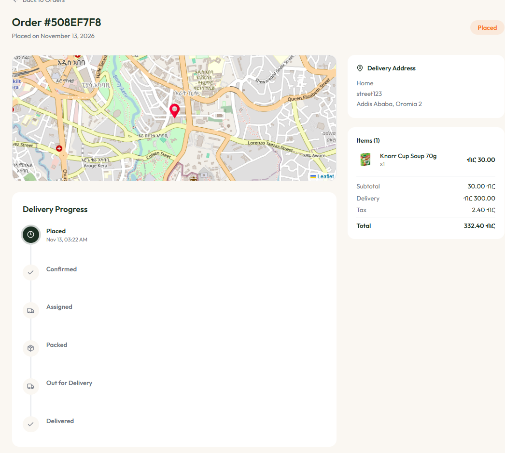
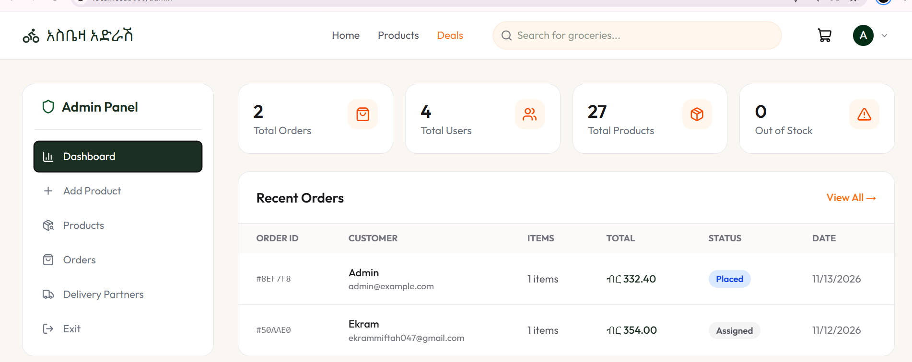
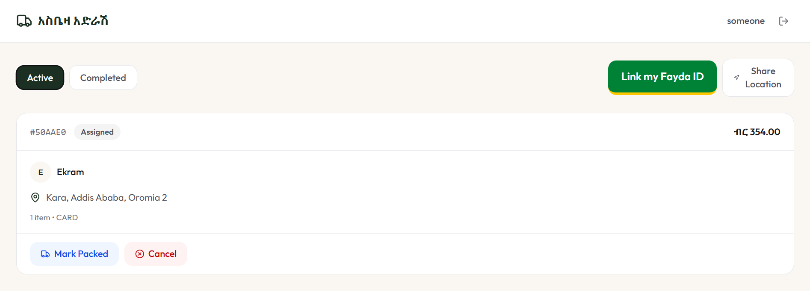

<div align="center">


### 🛒 Order groceries. Track them live. Hand-off confirmed with a one-time code.

<p>
  <a href="https://grocery-u7aa.vercel.app/"></a>
</p>

<p>
  
  
  
  
  
  
  
  
  
  
  
  
  
</p>

</div>

---

## 📑 Table of Contents

- [About the Project](#-about-the-project)
- [Key Features](#-key-features)
- [Visual Preview](#-visual-preview)
- [Tech Stack](#-tech-stack)
- [Architecture](#-architecture)
- [Database Design](#-database-design)
- [Project Structure](#-project-structure)
- [Getting Started](#-getting-started)
- [Environment Variables](#-environment-variables)
- [Fayda National ID Integration](#-fayda-national-id-integration-optional)
- [API Overview](#-api-overview)
- [Challenges and What I Learned](#-challenges-and-what-i-learned)
- [A Note from the Developer](#-a-note-from-the-developer)
- [Roadmap](#-roadmap)

---

## 🌟 About the Project

**Grocery Delivery App** is a full-stack grocery delivery platform built for the Ethiopian market, with prices in Ethiopian Birr (ብር). It brings three kinds of users together in one system:

- 🛍️ **Customers** browse products, check out securely, and watch their order move across a live map.
- 🧑‍💼 **Admins** manage the catalog, orders, and delivery partners from a dedicated dashboard.
- 🛵 **Delivery partners** accept deliveries, share their live location, and confirm the hand-off with a one-time code.

I built it over several months to practice designing a real, production-style system: authentication, payments, background jobs, email, image storage, geolocation, and deployment.

🌐 **Live demo:** [grocery-u7aa.vercel.app](https://grocery-u7aa.vercel.app/)

---

## ✨ Key Features

### 🛍️ Customer Experience
- 🔐 Secure sign-up and login with JWT authentication and hashed passwords
- 🥦 Product catalog with categories, search, filters, and a dedicated **Flash Deals** page
- 🏷️ Discount pricing (original vs. sale price), organic labels, ratings, and stock tracking
- 🛒 Persistent cart with a slide-out sidebar
- 📍 Address book with map-based location selection
- 💳 Multi-step checkout: address → payment → review
- 💰 **Two payment options:** Stripe card payments (confirmed through webhooks) and **Cash on Delivery**
- 📦 Order history and a visual **order timeline** with status updates
- 🗺️ **Live order tracking** on an interactive map
- 🔑 **OTP delivery confirmation:** the customer shares a code with the courier to complete the hand-off
- 📧 Email notifications

### 🧑‍💼 Admin Dashboard
- 📊 Dashboard overview
- 🧺 Full product management: create, edit, and delete products with Cloudinary image uploads
- 📋 Order management and status control
- 🛵 Delivery partner management
- 🛡️ Role-based access, with admin permissions controlled by an allow-list of admin emails

### 🛵 Delivery Partner Portal
- 🔓 Separate login and protected dashboard, with its own authentication middleware
- 📥 View and manage assigned orders
- 📡 Share live location with the customer while delivering
- ✅ Complete deliveries with OTP verification
- ❌ Cancel an order with a reason

### 🇪🇹 Local Integration
- 🪪 Optional sign-in and account linking with **Fayda**, Ethiopia's national digital ID (OpenID Connect with PKCE)
- 💱 Ethiopian Birr (ብር) currency formatting

### ⚙️ Engineering Highlights
- ⚡ Serverless-ready: Neon serverless PostgreSQL with the Prisma Neon adapter
- 🔁 Background jobs and event-driven workflows with **Inngest**
- 🧠 End-to-end TypeScript on both client and server
- 🌱 Database seed script for sample data
- 🚀 Deployed on Vercel (client and server)

---

## 📸 Visual Preview

### 🏠 Home
<div align="center">
  
</div>

### 🥦 Products and Cart
<div align="center">
  
</div>

### 💳 Checkout
<div align="center">
  
</div>

### 🗺️ Live Order Tracking
<div align="center">
  
</div>

### 🧑‍💼 Admin Dashboard
<div align="center">
  
</div>

### 🛵 Delivery Partner Dashboard
<div align="center">
  
</div>

---

## 🧰 Tech Stack

| Layer | Technologies |
|:---|:---|
| **Frontend** | React 19, TypeScript, Vite, Tailwind CSS 4, React Router 7, Axios, React Hot Toast, Lucide Icons |
| **Maps** | Leaflet, React-Leaflet |
| **Backend** | Node.js, Express 5, TypeScript (tsx) |
| **Database** | PostgreSQL on Neon (serverless), Prisma ORM |
| **Authentication** | JWT, bcrypt, Fayda eSignet (OIDC + PKCE, optional) |
| **Payments** | Stripe with webhooks, Cash on Delivery |
| **File Storage** | Cloudinary, Multer |
| **Background Jobs** | Inngest |
| **Email** | Nodemailer (SMTP) |
| **Deployment** | Vercel |
| **Tooling** | pnpm, ESLint, Nodemon |

---

## 🏗️ Architecture

```
┌──────────────────┐      REST / JSON       ┌───────────────────────┐
│  React + Vite    │ ─────────────────────▶ │   Express 5 API       │
│  (Customer,      │ ◀───────────────────── │   (TypeScript)        │
│  Admin, Delivery)│                        └──────────┬────────────┘
└──────────────────┘                                   │
                                                       │
        ┌───────────────┬──────────────┬───────────────┼───────────────┬──────────────┐
        ▼               ▼              ▼               ▼               ▼              ▼
   Neon Postgres     Stripe        Cloudinary       Inngest        Nodemailer     Fayda ID
   (via Prisma)    (payments +      (images)     (background       (emails)        (OIDC)
                    webhooks)                        jobs)
```

---

## 🗄️ Database Design

Built with Prisma on PostgreSQL.

| Model | Purpose |
|:---|:---|
| **User** | Customer accounts, optional Fayda ID link |
| **Address** | Saved delivery addresses with coordinates (deleted along with the user) |
| **Product** | Catalog items: pricing, discounts, stock, category, organic flag, ratings |
| **Order** | Items, shipping address, payment method and status, status history, delivery OTP, live location |
| **DeliveryPartner** | Courier accounts, vehicle type, active status, optional Fayda ID link |

Relations: `User 1─N Address`, `User 1─N Order`, `DeliveryPartner 1─N Order`

---

## 📂 Project Structure

```
Grocery/
├── client/                      # React + Vite frontend
│   ├── public/
│   └── src/
│       ├── assets/              # Images, category art, icons
│       ├── components/
│       │   ├── Checkout/        # Address, payment, review steps
│       │   ├── Delivery/        # OTP modal, cancel modal, order cards
│       │   ├── Home/            # Hero, categories, popular products
│       │   └── OrderTracking/   # Live map, OTP, timeline
│       ├── config/              # API client
│       ├── context/             # Auth and Cart providers
│       ├── pages/
│       │   ├── admin/           # Admin dashboard and management
│       │   └── delivery/        # Delivery partner portal
│       └── types/
│
├── server/                      # Express API
│   ├── config/                  # Prisma, Cloudinary, Nodemailer, Fayda, PKCE
│   ├── controllers/             # Business logic
│   ├── inngest/                 # Background job functions
│   ├── middleware/              # Auth, admin, delivery auth
│   ├── prisma/                  # schema.prisma
│   ├── routes/                  # API route definitions
│   ├── seed.ts                  # Database seeding
│   └── server.ts                # Entry point
│
└── screenshots/                 # Images used in this README
```

---

## 🚀 Getting Started

### Prerequisites

- Node.js 20 or newer
- [pnpm](https://pnpm.io/) (or npm)
- A [Neon](https://neon.tech) PostgreSQL database
- Accounts for Stripe, Cloudinary, Inngest, and an SMTP provider

### 1. Clone the repository

Open the repository page on GitHub, click the green **Code** button, copy the HTTPS link, and run:

```bash
git clone <the-link-you-copied>
# then open the folder that was just created
```

### 2. Set up the server

```bash
cd server
pnpm install
```

Create a `.env` file in the `server` folder using the variables listed [below](#-environment-variables), then run:

```bash
pnpm prisma db push     # create the tables in your database
pnpm seed               # optional: add sample products
pnpm server             # start the API with hot reload
```

The API runs on **http://localhost:5000**.

### 3. Set up the client

```bash
cd ../client
pnpm install
```

Create a `.env` file in the `client` folder (see below), then run:

```bash
pnpm dev
```

The app runs on **http://localhost:5173**.

### 4. Optional services

- **Stripe webhooks:** use the [Stripe CLI](https://docs.stripe.com/stripe-cli) to forward webhook events to your local server, then copy the signing secret it prints into `STRIPE_WEBHOOK_SECRET`.
- **Inngest:** run the local dev server with `npx inngest-cli@latest dev` to test background jobs.

---

## 🔐 Environment Variables

### Server (`server/.env`)

```env
# Database (Neon PostgreSQL)
DATABASE_URL=

# Auth
JWT_SECRET=
ADMIN_EMAILS=admin@example.com

# Cloudinary
CLOUDINARY_CLOUD_NAME=
CLOUDINARY_API_KEY=
CLOUDINARY_API_SECRET=

# Inngest
INNGEST_EVENT_KEY=
INNGEST_SIGNING_KEY=

# Email (SMTP)
SENDER_EMAIL=
SMTP_USER=
SMTP_PASS=

# Stripe
STRIPE_SECRET_KEY=
STRIPE_WEBHOOK_SECRET=

# Fayda National ID (optional, leave empty to disable)
CLIENT_ID=
REDIRECT_URI=http://localhost:3000/callback
AUTHORIZATION_ENDPOINT=https://esignet.ida.fayda.et/authorize
TOKEN_ENDPOINT=https://esignet.ida.fayda.et/v1/esignet/oauth/v2/token
USERINFO_ENDPOINT=https://esignet.ida.fayda.et/v1/esignet/oidc/userinfo
EXPIRATION_TIME=15
ALGORITHM=RS256
CLIENT_ASSERTION_TYPE=
PRIVATE_KEY=
```

### Client (`client/.env`)

```env
VITE_CURRENCY_SYMBOL=" ብር "
VITE_BASE_URL="http://localhost:5000/api"
```

> ⚠️ Never commit real `.env` files. They are excluded through `.gitignore`.

---

## 🪪 Fayda National ID Integration (Optional)

The project includes an integration with **Fayda**, Ethiopia's national digital ID, using OpenID Connect (authorization code flow with PKCE and signed client assertions). Customers and delivery partners can link their Fayda ID to their account.

This feature is **optional**. Production access requires a registered business license and tax ID, so the app runs fully without it: leave the Fayda variables empty and the rest of the platform works as normal.

---

## 🔌 API Overview

| Module | Responsibility |
|:---|:---|
| `authRoutes` | Registration, login, Fayda sign-in and linking |
| `productRoutes` | Browse, search, and filter products |
| `addressesRoutes` | Manage saved addresses |
| `orderRoutes` | Place orders, order history, tracking, payment |
| `adminRoutes` | Admin product, order, and partner management |
| `deliveryPartnerRoutes` | Courier login, assigned orders, live location, OTP verification |
| `uploadRoutes` | Image uploads to Cloudinary |
| `webhooks` | Stripe payment confirmation |

---

## 💡 Challenges and What I Learned

- **Live tracking:** storing and updating a courier's location on the order and rendering it smoothly on a Leaflet map.
- **Secure hand-off:** designing an OTP flow so an order is only completed when the customer and courier confirm each other.
- **Payments you can trust:** relying on Stripe webhooks, not the browser redirect, to mark card orders as paid, while still supporting Cash on Delivery.
- **Three roles, one system:** separating customer, admin, and delivery partner access with dedicated middleware.
- **Serverless database access:** running Prisma on Neon with the serverless driver adapter.
- **Standards-based identity:** implementing OpenID Connect with PKCE for Ethiopia's national ID.
- **Asynchronous workflows:** moving slow work like emails into background jobs with Inngest.

---

## 💚 A Note from the Developer

This project took me months, and it was not always easy. There were nights when a bug refused to die, when a payment flow worked everywhere except where it mattered, when a map stubbornly showed the wrong place. Every one of those moments taught me something that no tutorial could.

I wanted to build something that felt real: an app that a family could use to put food on the table, a courier could trust to do their job, and a shop owner could run with confidence. I built it with Ethiopian customers in mind, from the Birr pricing to the Fayda ID integration, because I believe good software should fit the people who use it.

If you are reading this, thank you for taking the time. I am proud of how far this project came, and I am even more excited about what I will build next.

---

## 🗺️ Roadmap

- [ ] Product reviews submitted by real customers
- [ ] Push and SMS notifications
- [ ] Automated tests (unit and end-to-end)
- [ ] Multi-language support (Amharic)
- [ ] Mobile app

---

<div align="center">

⭐ If you like this project, consider giving it a star!


</div>
